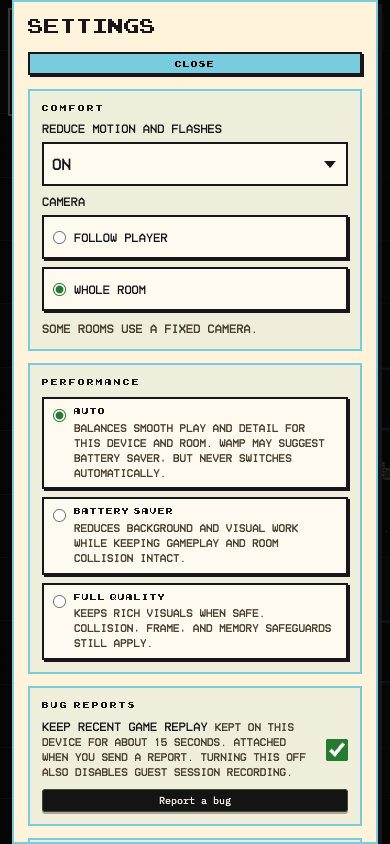

# F173 — Comfort settings and a remembered camera choice

Complete and verified live. PR #193 source `08ebdc8b`, main `c949c360`, Pages `f185351c` (`https://f185351c.wampland.pages.dev`). The API Worker is `09f01495-1b49-437e-9dcb-4cfea2560313`: current main also includes the independently merged Room video feature (PR #185), whose shared room schema needed the matching API delivery. No room was edited or republished.

Settings now starts with a Comfort section. **Reduce motion and flashes** offers **Use system setting**, **On** and **Off**; **Camera** offers **Follow player** and **Whole room**. Choices are remembered on this device, like its performance and frame-rate settings. The default follows the system's reduced-motion preference and keeps the player-follow camera. Account settings and authentication are unchanged.

The motion choice controls the existing gameplay gates for combat/stomp shake, PvP full-screen flash/shake, flickering lights, comment motion and reward/XP animation. System changes update the effective choice without a reload. CSS and gameplay share the same preference; Off can override a system motion reduction. Room-camera transitions snap immediately with reduced motion enabled.

Whole room uses the existing room-centered camera framing. It stays steady while the player moves and fits the current room on portrait screens. Follow restores tracking. Rooms authored with a fixed camera keep their framing; this preference does not rewrite room data or turn the stationary Inspect mode into a user setting. Camera settings use scalar getters in the play loop.

Verification: all 3,538 tests and full quality gates pass. Native desktop/Chromium phone/WebKit phone checks cover real settings controls, 44px targets, no horizontal overflow, saved choices after reload, live system changes, whole-room movement, restored Follow, and PvP/reward effects with On/Off. Screenshots were inspected; Camera label contrast and Safari's short native menu were corrected. The installed game client exercised movement/jump in a published safety room without runtime error files. The existing authored-room camera smoke also passes editor save/reload, framing during movement/zoom input, portrait resizing, neighboring-room transition and respawn. Evidence: `/tmp/wamp-f173-2026-10-13/`.

These are browser/device-emulation checks, not a new hands-on iPhone check. The safety welcome room is absent, so the game client used published room `1,-14`; controlled camera checks used an isolated synthetic editor room and blocked API mutations/socket traffic. Startup JavaScript remains below the 670KB brotli gate (649.6KB in the first full build; final combined-main build is 650.8KB).

Live proof: the custom domain and immutable Pages host serve matching entry JavaScript/CSS/bootstrap hashes; controls are present on both. Native Chrome desktop and phone checks verify saved/reloaded choices, keyboard radio selection, real keyboard/touch jump and unchanged whole-room framing, with no exceptions and no private game object exposed. Current main passes 3,545 tests and all four hosted checks. Both guarded Pages and matching API releases pass production smoke, health and the unchanged renderer contract.

A fresh recording notice overlaps the phone Jump button's center; this is a pre-existing mobile issue, recorded for the next fix. Live gameplay checks dismissed it via its real opt-out control before testing jump.
