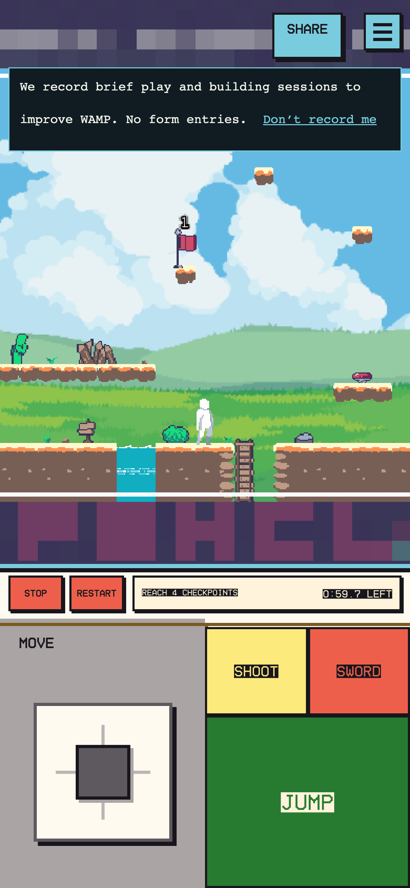

# Phone recording notice — F089 follow-up

Delivered and verified live: PR #194 source `4bdb0dca`, main `dd866ceb`, Pages `b1e7c86d` (`https://b1e7c86d.wampland.pages.dev`). Found while verifying the live Comfort release. On a fresh phone visit, the guest recording notice sat over the center of the Jump button; real touch input hit the notice instead. Dismissing it through its opt-out control restored jump.

The notice now sits below the phone's top controls and above the movement/action deck during play. Its opt-out button is at least 44px tall. Desktop placement and recording/opt-out behavior are unchanged.

The mobile suite now includes a fresh recording-notice case. It checks that Jump, Sword, Shoot, Move, Stop and Restart do not overlap the notice and that each control's center hits the control. It also checks the opt-out target size. All 13 phone/tablet scenarios pass, with no console or page errors and no missing recorded API fixtures. Full 3,545-test quality gates pass. Source and merge have all four hosted checks green; the guarded Pages release passes production smoke. On the custom domain with the notice visible, all six control centers hit the control and actual touch Jump lifts the player while whole-room framing stays steady. No exceptions. The installed game client also passes movement/jump and its screenshot was inspected.

This extends F089; remaining keyboard scenarios and a hands-on iOS Safari check stay open. Production baseline evidence and the corrected candidate screenshot are retained under `/tmp/wamp-f173-2026-10-13/` and `output/web-game/mobile-smoke-ci/phone-portrait-recording-notice/`.
